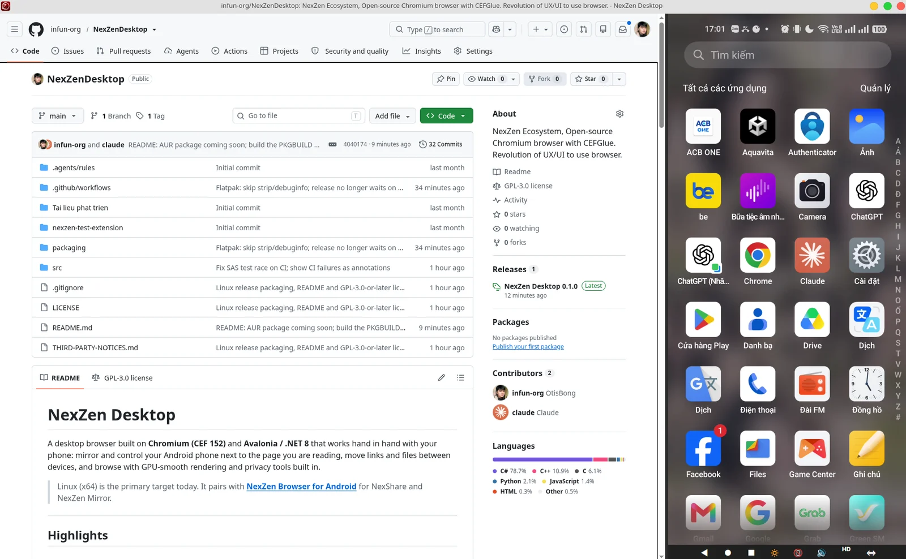
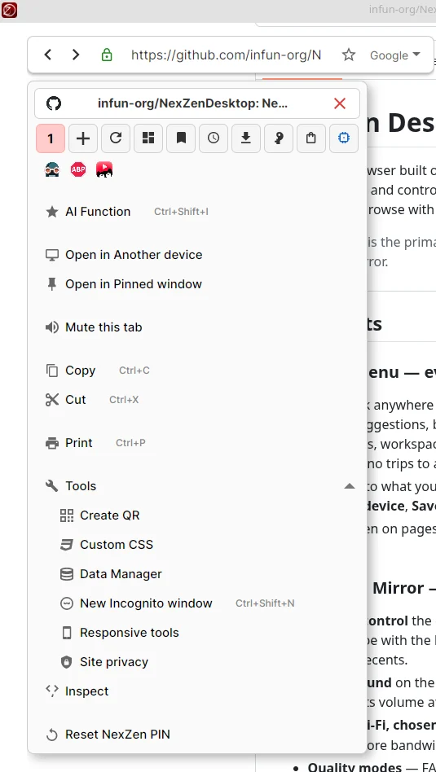
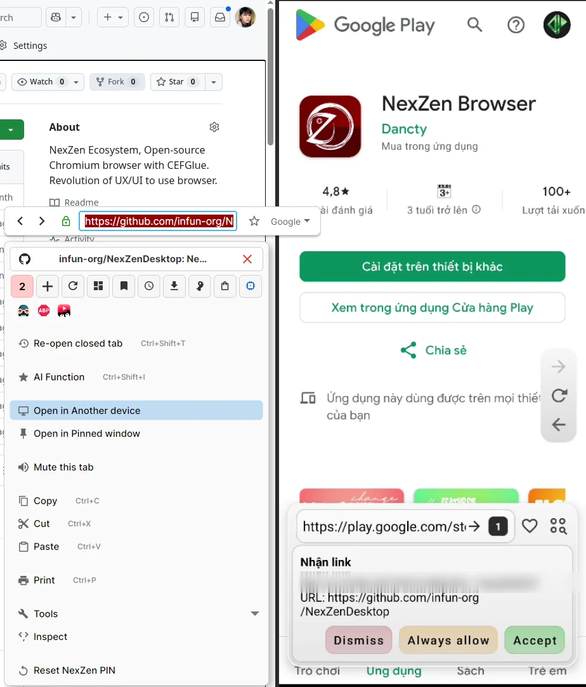
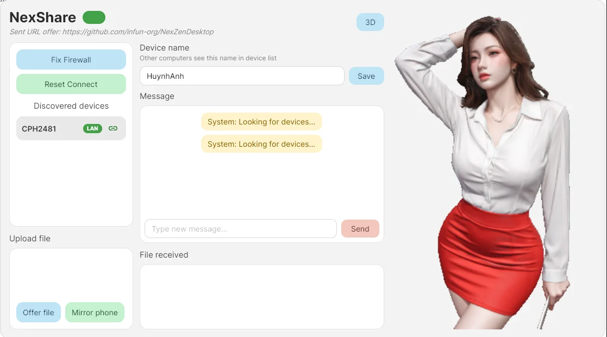
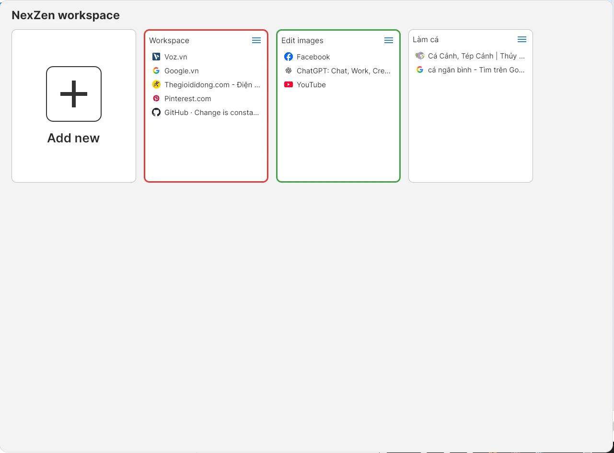
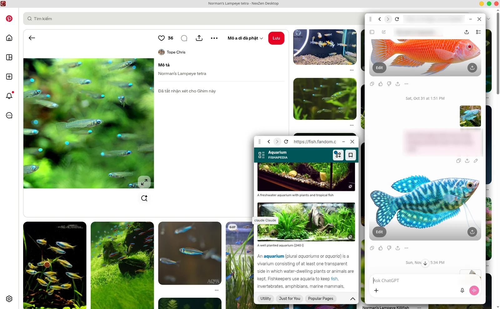
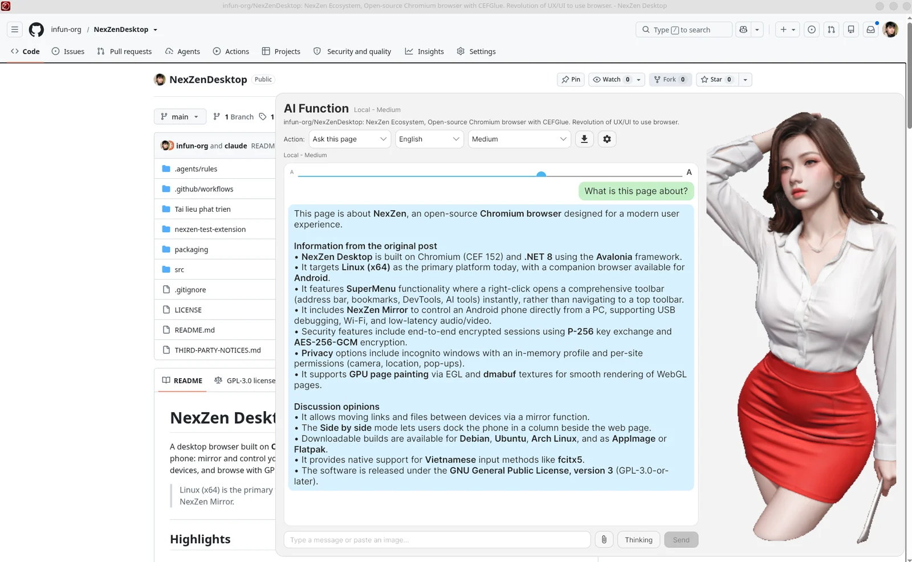
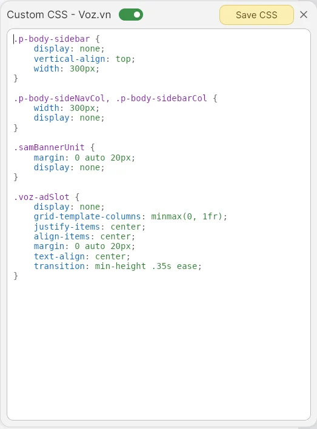

# NexZen Desktop

A desktop browser built on **Chromium (CEF 152)** and **Avalonia / .NET 8** that works hand in hand with your phone:
mirror and control your Android phone next to the page you are reading, move links and files between devices,
and browse with GPU-smooth rendering and privacy tools built in.

<p align="center"></p>

> Linux (x64) is the primary target today. It pairs with **[NexZen Browser for Android](https://play.google.com/store/apps/details?id=com.infun.nexzenbrowser)** for NexShare and NexZen Mirror.

---

## Highlights

### 🎯 SuperMenu — everything one right-click away
- Right-click anywhere on a page and the **SuperMenu opens right under the cursor**: address bar with search
  suggestions, back / forward / reload, tabs, bookmarks, history, downloads, saved passwords, extensions, workspaces,
  tools (Custom CSS, Site privacy, Print, DevTools, AI Function) and sharing to your phone — no trips to a toolbar at
  the top of the screen.
- It adapts to what you clicked: **Copy / Cut / Paste**, **Open in new tab / new window / pinned window / another
  device**, **Save image**, **Copy image address**, **Create QR**.
- Works even on pages that block the context menu: **Shift + right-click** or a **double right-click** always opens it.

<p align="center"></p>

### 📱 NexZen Mirror — your phone on the PC
- **See and control** the connected Android phone: click, swipe and long-press with the mouse, scroll with the wheel,
  type with the keyboard (including Vietnamese input methods such as fcitx5 / Lotus / Unikey), Back / Home / Recents.
- **Phone sound** on the computer (Opus/AAC, low latency); the phone mutes itself while mirroring and restores its volume afterwards.
- **USB or Wi-Fi, chosen automatically**: with USB debugging on, the session runs through an `adb forward` tunnel
  (more bandwidth, less delay); otherwise over the LAN / Wi-Fi Direct link.
- **Quality modes** — FAST (1000 px), SD (1600 px), HD (1920 px) — switchable live, with adaptive bitrate and
  congestion control that keeps the picture close to real time.
- **Side by side**: dock the mirror into a column beside the web page, or keep it in its own window.
- **Secure by design**: every session runs its own P-256 key exchange and shows the same 6-digit code on both screens;
  video, audio and input are end-to-end encrypted (AES-256-GCM) with replay protection.

### 🔗 NexShare — phone ⇄ computer
- Discovery over **Bluetooth LE** and the **LAN**, pairing with ECDH and a short authentication string, then transfer over
  **Wi-Fi Direct** or the local network.
- Send **links, text and files** in both directions; open the page you are reading on another device.
- **Open in Another device** from the SuperMenu: the phone asks before opening the link (Accept / Always allow / Dismiss).

<p align="center">
  
  
</p>

### ⚡ Fast and smooth
- **GPU page painting**: frames are shared from Chromium as dmabuf textures and drawn through EGL — full-screen WebGL /
  three.js pages stay smooth instead of being copied back to system memory.
- **Quick start**: CEF and EF Core initialise in the background while the window loads (≈2.4 s to a visible window
  on the development machine).

### 🛡️ Privacy and security
- **Incognito windows** with the full NexZen interface on an in-memory profile (no history, downloads list or saved
  passwords; everything is gone when the last incognito window closes).
- **Site privacy**: per-site permissions (camera, location, pop-ups, sound, …), storage usage and one-click data deletion.
- **Domain lock** with your NexZen PIN and a **password vault** protected by a PIN.

### 🗂️ Workspaces
- Save a **set of tabs as a workspace** (e.g. "Work", "Research", "Shopping") with a name, a colour and site icons.
- **Open a workspace in its own window** in one click: all of its tabs load together, the window gets a coloured
  frame and the workspace name in its title, so several projects stay apart.
- Add the current tab to a workspace, open a single tab from it, edit or delete it from the Workspaces window;
  workspaces are stored locally and shared by all NexZen windows.

<p align="center"></p>

### 🧰 Everyday browsing
- **New tab page** with a centred address bar, shortcuts with site icons, and your own background picture.
- **Pinned windows**: open any link in a small floating browser that stays on top of the page, with its own
  back / forward / reload, so a chat, a reference page or a video stays in view while you browse.
- **Per-site Custom CSS**: restyle any site with your own CSS (syntax-highlighted editor, applied on every visit).
- **Tab switcher** (Ctrl+Tab), **Print** with page setup and live preview, built-in **DevTools** (F12),
  **Chrome extensions**, device-size **page views**.
- **AI Function**: an assistant that can read the current page, with support for local models.
- **Read aloud**: SuperMenu → *Read page aloud* / *Read selection aloud* reads with a natural local voice
  ([ZONOS3-Mini](https://huggingface.co/Zyphra/ZONOS3-Mini), on this computer, no cloud). Vietnamese numbers, dates,
  money, units and common abbreviations are spelled out, and every sentence is levelled to the same loudness.
  The voice (about 1.1 GB) is downloaded on first use.
- **NexZen Voice** (SuperMenu → Tools): read any text, save it as WAV, pick the speed, and make a voice from
  your own recording.
- Careful **keyboard/IME** handling for Vietnamese typing in web pages (fcitx5), numpad that follows NumLock.

<p align="center"></p>
<p align="center"></p>
<p align="center"></p>

---


## Download

| Platform | How to get it |
|---|---|
| **Linux x64** — portable | `nexzen-desktop-<version>-linux-x64.tar.gz` from [GitHub Releases](https://github.com/infun-org/NexZenDesktop/releases/latest): extract anywhere and run `./nexzen-desktop` |
| **Linux x64** — AppImage | `NexZen-<version>-x86_64.AppImage` from [GitHub Releases](https://github.com/infun-org/NexZenDesktop/releases/latest): `chmod +x` and run |
| **Debian / Ubuntu** (Ubuntu 22.04+, Debian 12+) | `nexzen-desktop_<version>_amd64.deb` from [GitHub Releases](https://github.com/infun-org/NexZenDesktop/releases/latest): `sudo apt install ./nexzen-desktop_*_amd64.deb` |
| **Fedora / openSUSE** | `nexzen-desktop-<version>-1.x86_64.rpm` from [GitHub Releases](https://github.com/infun-org/NexZenDesktop/releases/latest): `sudo dnf install ./nexzen-desktop-*.x86_64.rpm` |
| **Arch Linux / CachyOS / Manjaro** | AUR package coming soon (AUR sign-ups are currently closed). Meanwhile use the AppImage / tarball, or build [`packaging/aur/PKGBUILD`](packaging/aur/PKGBUILD) with `makepkg -si` |
| **Flatpak** | `NexZen-<version>-x86_64.flatpak` from [GitHub Releases](https://github.com/infun-org/NexZenDesktop/releases/latest): `flatpak install --user ./NexZen-*.flatpak` (mirroring over USB is not available inside the Flatpak sandbox; Wi-Fi works) |
| **Android** (phone companion) | [NexZen Browser on Google Play](https://play.google.com/store/apps/details?id=com.infun.nexzenbrowser) |
| Windows, macOS | not supported yet |

Every package bundles the Chromium (CEF 152) and .NET 8 runtimes, so nothing else has to be installed
for browsing. NexZen Mirror additionally uses the system **FFmpeg** libraries and **PulseAudio/PipeWire**
(and **adb** for mirroring over USB). Linux builds run on X11 or XWayland (tested on KDE Plasma);
native Wayland is experimental (`NEXZEN_FORCE_WAYLAND=1`).

The installed app keeps its data in `~/.local/share/NexZenDesktop`.

---

## Build from source

### Requirements
- **.NET 8 SDK** (the solution file `src/NexZenDesktop.slnx` builds with a recent .NET SDK)
- **CEF 152 for Linux x64** — a `cef_binary_152.*_linux64_minimal` distribution from
  <https://cef-builds.spotifycdn.com/index.html>
- **FFmpeg libraries** (`libavcodec`, `libavutil`, `libswscale`) for NexZen Mirror video/audio decoding
- **PulseAudio or PipeWire** (pulse) for mirrored phone sound
- *Optional:* **adb** (Android platform-tools) for mirroring over USB

### Build
Tell the build where CEF 152 is (first match wins):

```bash
dotnet build src/NexZenDesktop.slnx -p:Cef152Root=/path/to/cef_binary_152...linux64_minimal
```

or set `NEXZEN_CEF152_ROOT`, or place/symlink the CEF build at `third_party/cef152`.
After the build, `use-cef152.sh` links the CEF runtime files next to the browser subprocess.

### Run

```bash
src/NexZen.Desktop/bin/Debug/net8.0/NexZen.Desktop
```

### Package a release
`packaging/linux/build-release.sh --version <x.y.z> --cef <cef root>` builds the release tree and tarball
(stripped CEF 152 runtime, bundled .NET 8 runtime, launcher, desktop entry with New Window / New Incognito
Window actions); `packaging/linux/make-packages.sh deb rpm appimage` turns it into packages. Pushing a
`v*` tag runs the same steps in GitHub Actions and drafts a release (`.github/workflows/release.yml`).

Launching NexZen again while it runs opens a new NexZen window in the running instance
(`--incognito` / `--private-window` opens an incognito window), so desktop-entry actions such as
“New Window” and “New Incognito Window” work as expected.

### Useful environment variables

| Variable | Effect |
|---|---|
| `NEXZEN_GPU_PAINT=0` | Turn off GPU page painting (use the copying path) |
| `NEXZEN_FRAMERATE=<n>` | Override the windowless frame rate |
| `NEXZEN_START_URL=<url>` | Page for the first tab |
| `NEXZEN_RENDER_TRACE=1` | Per-second paint statistics |
| `NEXZEN_CEF_SYNC_INIT=1` | Initialise CEF on the UI thread (old start-up order) |
| `NEXZEN_FORCE_WAYLAND=1` | Use native Wayland instead of X11 |

---

## Project layout

```
src/
  NexZen.Core/            Entities, interfaces, NexShare & Mirror protocol, crypto helpers
  NexZen.Application/     View models and services (NexShare orchestrator, Mirror client, stores)
  NexZen.Infrastructure/  EF Core (SQLite), BLE (BlueZ), LAN/WebSocket transports, crypto
  NexZen.Desktop/         Avalonia app: browser windows, Mirror, NexShare, settings windows
  NexZen.Tests/           xUnit tests (protocols, crypto, stores, view models)
  libs_cefglue/           CefGlue fork: CEF 152 bindings, OSR/GPU painting, Avalonia integration
```

## Related
- **[NexZen Browser for Android](https://play.google.com/store/apps/details?id=com.infun.nexzenbrowser)** — the phone app on Google Play (Gecko-based browser, NexShare,
  NexZen Mirror sender).

## Status
NexZen Desktop is under active development; Linux x64 is the supported platform today.

## License
Copyright © 2026 Infun

NexZen Desktop is free software: you can redistribute it and/or modify it under the terms of the
**GNU General Public License**, version 3 or (at your option) any later version (`GPL-3.0-or-later`) — see [`LICENSE`](LICENSE). You may use, study, share and change it; if you
distribute a modified version, you must make its source code available under the same license.

Third-party components and their licenses are listed in [`THIRD-PARTY-NOTICES.md`](THIRD-PARTY-NOTICES.md).
